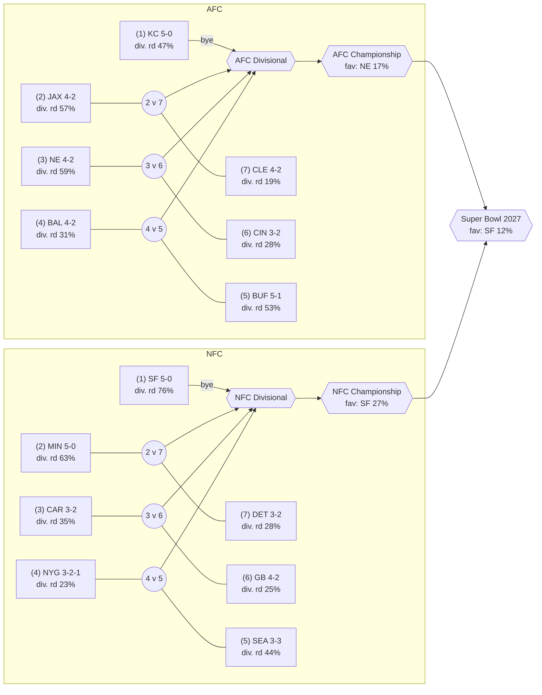
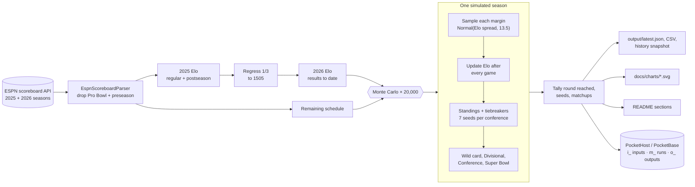
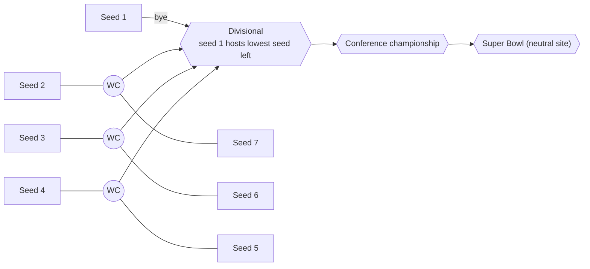
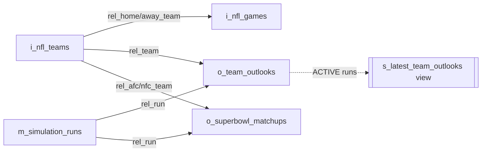

# 🏈 NFL Super Bowl & Playoff Survival Odds (Kotlin Multiplatform)

Live 2026 NFL season model: it pulls every result from ESPN's public scoreboard API, builds margin-of-victory
**Elo power ratings**, then runs a **Monte Carlo simulation** of the rest of the regular season, NFL seeding and
tiebreakers, and the full 14-team playoff bracket. The output is each team's chance of making the playoffs,
surviving each round, and winning **Super Bowl LXI** (February 2027).

Sibling project to [`mlb_sabermetric_worldseries_kmp`](../mlb_sabermetric_worldseries_kmp), using the same
Kotlin Multiplatform layout, Gradle wrapper, and refresh-and-sync workflow.

<!-- SUMMARY:START -->
_Updated 2026-10-19 · 2026 season through week 6 (92 games played, 180 remaining) · 200 simulations._

**Favorites:** San Francisco 49ers 12% · Minnesota Vikings 11% · Buffalo Bills 9.0%
**Most likely Super Bowl:** NE vs SF (6.0%)
<!-- SUMMARY:END -->

## 🏆 Super Bowl win probability


## 🧗 Playoff survival by round

Each cell is the probability a team reaches that round, so reading across a row shows how quickly its odds fall off.


## 📋 Full leaderboard

<!-- LEADERBOARD:START -->
| # | Team | Record | Elo | Proj. W | Division | Playoffs | Divisional | Conf. game | Super Bowl | **Win SB** |
|---:|---|:---:|---:|---:|---:|---:|---:|---:|---:|---:|
| 1 | San Francisco 49ers | 5-0 | 1660 | 13.3 | 83% | 96% | 76% | 47% | 27% | **12%** |
| 2 | Minnesota Vikings | 5-0 | 1613 | 12.3 | 63% | 91% | 63% | 40% | 22% | **11%** |
| 3 | Buffalo Bills | 5-1 | 1635 | 11.8 | 47% | 89% | 53% | 29% | 16% | **9.0%** |
| 4 | New England Patriots | 4-2 | 1634 | 11.2 | 50% | 87% | 59% | 32% | 17% | **9.0%** |
| 5 | Seattle Seahawks | 3-3 | 1655 | 10.2 | 16% | 70% | 44% | 24% | 14% | **8.5%** |
| 6 | Jacksonville Jaguars | 4-2 | 1621 | 11.4 | 77% | 90% | 57% | 31% | 16% | **8.0%** |
| 7 | Kansas City Chiefs | 5-0 | 1563 | 11.2 | 55% | 81% | 47% | 26% | 14% | **7.5%** |
| 8 | Denver Broncos | 4-2 | 1603 | 10.7 | 41% | 74% | 49% | 25% | 12% | **5.0%** |
| 9 | Detroit Lions | 3-2 | 1530 | 9.4 | 17% | 54% | 28% | 13% | 9.5% | **4.5%** |
| 10 | Carolina Panthers | 3-2 | 1516 | 9.3 | 59% | 66% | 35% | 15% | 7.0% | **4.5%** |
| 11 | Baltimore Ravens | 4-2 | 1543 | 9.7 | 27% | 54% | 31% | 16% | 6.5% | **3.5%** |
| 12 | Pittsburgh Steelers | 4-2 | 1542 | 9.6 | 25% | 53% | 28% | 13% | 5.0% | **3.5%** |
| 13 | Green Bay Packers | 4-2 | 1522 | 9.5 | 13% | 57% | 25% | 13% | 6.0% | **2.5%** |
| 14 | Chicago Bears | 4-2 | 1560 | 9.8 | 8.5% | 60% | 30% | 14% | 6.0% | **2.0%** |
| 15 | Cincinnati Bengals | 3-2 | 1515 | 9.6 | 27% | 56% | 28% | 8.5% | 6.0% | **1.5%** |
| 16 | Houston Texans | 2-4 | 1545 | 8.3 | 17% | 35% | 17% | 8.5% | 3.0% | **1.5%** |
| 17 | Las Vegas Raiders | 3-3 | 1437 | 7.6 | 4.5% | 16% | 6.0% | 3.0% | 2.0% | **1.5%** |
| 18 | Cleveland Browns | 4-2 | 1476 | 9.4 | 21% | 50% | 19% | 6.0% | 1.5% | **1.0%** |
| 19 | Atlanta Falcons | 2-4 | 1466 | 7.0 | 16% | 24% | 16% | 7.0% | 2.0% | **1.0%** |
| 20 | New Orleans Saints | 2-4 | 1444 | 7.3 | 16% | 22% | 11% | 2.5% | 1.0% | **1.0%** |
| 21 | New York Jets | 2-4 | 1396 | 6.2 | 3.5% | 7.0% | 3.0% | 1.0% | 0.5% | **0.5%** |
| 22 | Indianapolis Colts | 2-4 | 1434 | 6.7 | 5.5% | 8.5% | 2.5% | 1.5% | 0.5% | **0.5%** |
| 23 | New York Giants | 3-2-1 | 1448 | 8.0 | 41% | 44% | 23% | 7.5% | 2.0% | **0.5%** |
| 24 | Washington Commanders | 1-3-1 | 1407 | 6.1 | 13% | 14% | 7.0% | 2.5% | 1.0% | **0.5%** |
| 25 | Arizona Cardinals | 2-4 | 1399 | 6.4 | 0% | 4.0% | 2.0% | 1.0% | 0.5% | **0.5%** |
| 26 | Miami Dolphins | 0-5 | 1373 | 4.0 | 0.5% | 1.5% | 0.5% | 0.5% | 0% | **0%** |
| 27 | Tennessee Titans | 1-5 | 1350 | 4.5 | 1.5% | 2.0% | 0.5% | 0% | 0% | **0%** |
| 28 | Los Angeles Chargers | 0-6 | 1407 | 4.0 | 0% | 0% | 0% | 0% | 0% | **0%** |
| 29 | Dallas Cowboys | 2-4 | 1431 | 6.7 | 21% | 25% | 14% | 5.5% | 1.0% | **0%** |
| 30 | Philadelphia Eagles | 2-4 | 1459 | 7.2 | 27% | 31% | 11% | 2.5% | 1.0% | **0%** |
| 31 | Tampa Bay Buccaneers | 1-5 | 1420 | 5.4 | 9.5% | 12% | 6.0% | 3.5% | 1.0% | **0%** |
| 32 | Los Angeles Rams | 2-4 | 1554 | 8.2 | 1.5% | 34% | 12% | 4.0% | 0% | **0%** |
<!-- LEADERBOARD:END -->

_Columns: **Division** = win the division · **Playoffs** = earn one of 7 seeds · **Divisional** = reach the
divisional round (a #1 seed bye or a wild-card win) · **Conf. game** = reach the conference championship ·
**Super Bowl** = win the conference · **Win SB** = win it all._

## 🗺️ Projected bracket (most likely seeding)

Seeds are assigned greedily: each seed goes to the team most likely to hold it. Labels show each team's
chance of reaching the divisional round.

<!-- BRACKET:START -->

<!-- BRACKET:END -->

## 🤝 Most likely Super Bowl matchups

<!-- MATCHUPS:START -->
| AFC | NFC | Probability |
|---|---|---:|
| NE | SF | 6.0% |
| BUF | MIN | 5.5% |
| BUF | SF | 5.0% |
| NE | MIN | 4.5% |
| KC | SF | 4.0% |
| CIN | SF | 3.5% |
| JAX | SF | 3.0% |
| BAL | MIN | 2.5% |
| BAL | SEA | 2.5% |
| KC | DET | 2.5% |
<!-- MATCHUPS:END -->

## 📈 Odds over the season

<!-- TREND:START -->
_The trend chart appears once a second weekly snapshot exists in `output/history/`._
<!-- TREND:END -->

## ⚡ Power ratings


## 🔄 How it works



### Playoff format simulated



The higher seed hosts every game until the Super Bowl. See [docs/METHODOLOGY.md](docs/METHODOLOGY.md) for
the equations, the tiebreakers, and the model's known limitations.

## 🗄️ PocketHost database

Every refresh is written to the PocketBase instance **`https://nfl-superbowl-predictions.pockethost.io`** on
[PocketHost](https://pockethost.io), configured through `POCKETHOST_URL`. The database is
**required** by default: a run fails fast, before fetching anything, if settings are missing. Full design,
including the ER diagram, migrations, foreign keys, and index rationale, is in **[docs/DATABASE.md](docs/DATABASE.md)**.



- **Setup:** create an instance on pockethost.io, then copy `.env.example` to `.env` (git-ignored) and fill in
  `POCKETHOST_URL`, `POCKETHOST_USER`, and `POCKETHOST_PASSWORD`. The older `POCKETHOST_ADMIN_*` names also work.
  Values are read from the environment first, then `./.env`, then `~/.env`. `just db-health` checks the instance.
- **Stepwise migrations**, recorded in `tbl_schema_migrations`: `001_base_tables`, then `002_foreign_keys` (required,
  non-cascading `rel_` relations), then `003_indexes` (unique natural keys, an index on every FK, query and partial
  indexes), then `004_summary_views`. Each step is idempotent, additive only, and repairs drift.
- **Idempotent writes:** rows are upserted on their natural key, so unchanged rows are skipped, changed rows are
  PATCHed (keeping their creation time), and new rows are POSTed. Rows are never deleted. Earlier runs become `SUPERSEDED`.
- **Resilience:** `_superusers` auth (PocketBase ≥ 0.23) with the token kept in memory only, plus exponential
  back-off with jitter on 429 / 5xx / network errors.
- **Replicas and backups:** after each sync, PocketHost (the source of truth) is pulled back into a timestamped
  JSON backup (`backups/`), a fresh SQLite file (`output/db/`), and local PostgreSQL on `localhost:15432`, set up
  per the DbFactory rule. Every store shares the same tables, foreign keys, indexes, and view.
- `just refresh-local` (`--db off`) runs without the database.

### 🔎 Querying it

- **TypeScript ([`clients/ts`](clients/ts)):** a strictly typed, read-only PocketBase client. It has types generated
  from the Kotlin schema, JDBI-style `{:param}` query templates whose parameter types are inferred at compile time,
  injection-safe binding, runtime record validation, retries, and `Result` errors. Built with bun.
- **Kotlin / JVM:** [JDBI](https://jdbi.org) SqlObject templates (`ReplicaQueries.kt`) over the SQLite and
  PostgreSQL replicas, with named parameters, typed row classes, enums, and `Instant`s. The same query catalogue
  runs on both dialects.

## 🚀 Run it

```bash
just refresh                 # fetch live data, simulate, regenerate charts + README, sync PocketHost
just refresh-local           # same, without the database
just db-health               # ping the configured PocketHost instance
just db-up                   # start local PostgreSQL (local-db-stack) for the replica
just test                    # tests + JaCoCo report + ≥90% line/branch coverage gate
just ts-check                # TypeScript client: tests + coverage, strict typecheck, build
just check-all               # both
./gradlew run -PsimArgs="--season 2026 --iterations 50000 --seed 7 --db off"
NFL_LIVE=1 ./gradlew jvmTest # also hit the real ESPN API
```

Needs JDK 21. Completed seasons are cached in `.cache/espn/`, and the in-progress season is refetched on every run.
Each run also writes `output/history/<date>.json`, and those snapshots feed the odds-over-time chart.

## 📂 Layout

| Path | What |
|---|---|
| `src/commonMain/.../model` | League registry (32 teams, divisions), `Game`, `Round` |
| `src/commonMain/.../engine` | `EloModel`, `SeasonTable`, `Seeding` (tiebreakers), `Playoffs`, `SeasonSimulator` |
| `src/commonMain/.../data` | ESPN JSON parser (multiplatform) |
| `src/commonMain/.../report` | Probabilities, Markdown fragments, dependency-free SVG charts |
| `src/jvmMain/.../data` | HTTP client and on-disk cache |
| `src/commonMain/.../sync` | PocketBase schema (collections, Hungarian columns) and record mapping |
| `src/jvmMain/.../sync` | PocketBase REST client: auth, migrations, upserts, back-off |
| `src/jvmMain/.../replica` | PocketHost snapshot, JSON backups, SQLite/PostgreSQL rebuilds, DbFactory, JDBI query templates |
| `clients/ts/` | Typed TypeScript PocketBase client (bun); `src/generated/schema.ts` is generated by the Kotlin pipeline |
| `src/jvmMain/.../app` | `Pipeline` (end-to-end refresh) and `Main` CLI |
| `output/` | `latest.json`, `team_outlook.csv`, `history/` snapshots |
| `docs/schema/` | PocketBase import JSON (generated each run) |

_Data: ESPN public scoreboard API (unofficial, not affiliated). This is a statistical model for fun, not betting advice._
