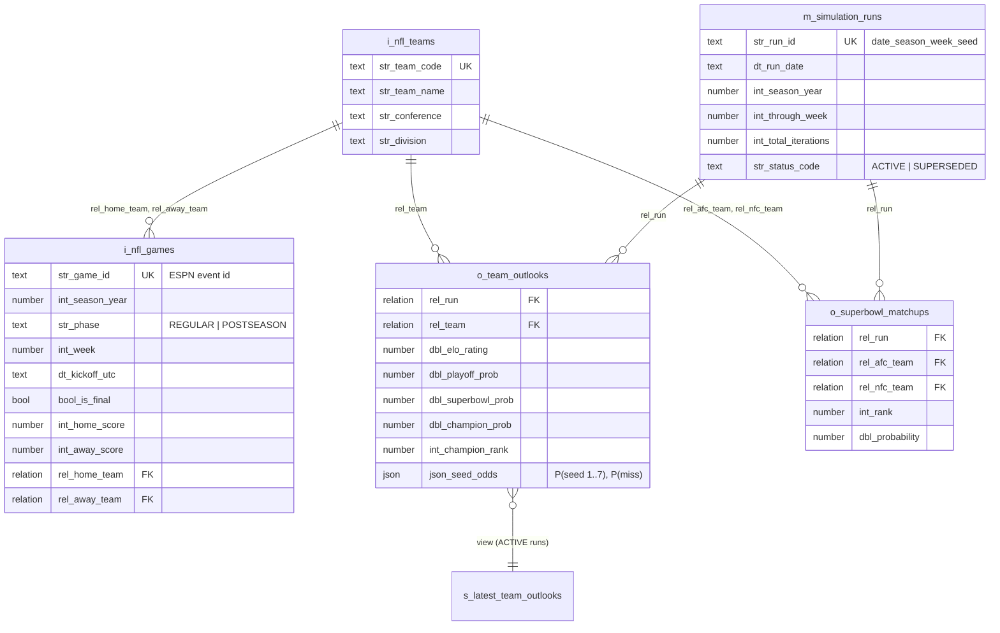
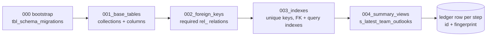
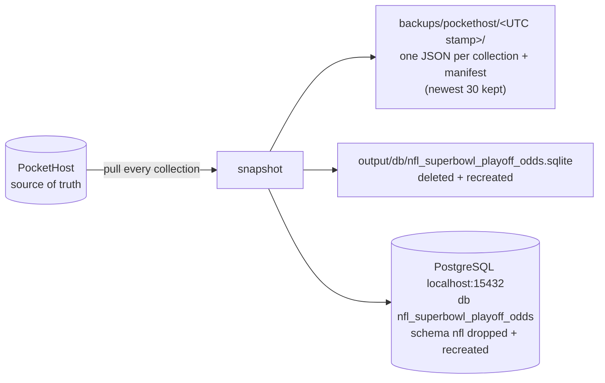

# PocketHost / PocketBase database

Defined in a single place, [`PocketBaseSchema.kt`](../src/commonMain/kotlin/com/gridiron/superbowl/sync/PocketBaseSchema.kt),
and applied by [`PocketBaseClient.migrate()`](../src/jvmMain/kotlin/com/gridiron/superbowl/sync/PocketBaseClient.kt)
at the start of every refresh. Targets PocketBase ≥ 0.23 (`_superusers` auth, `fields` schema format).

## Conventions

| Prefix | Meaning | Here |
|---|---|---|
| `i_` | input data | `i_nfl_teams`, `i_nfl_games` |
| `m_` | model runs | `m_simulation_runs` |
| `o_` | model output | `o_team_outlooks`, `o_superbowl_matchups` |
| `s_` | summary (read-only view) | `s_latest_team_outlooks` |
| `tbl_` | infrastructure | `tbl_schema_migrations` |

- Columns are Hungarian snake_case: `str_`, `int_`, `dbl_`, `bool_`, `json_`, `dt_`, and `rel_` for foreign keys.
- Every row carries `bool_is_active`, `str_status_code`, `int_created_epoch_ms_utc`, and `int_updated_epoch_ms_utc`.
- **Rows are never deleted.** Status moves through ACTIVE → SUPERSEDED (or INACTIVE / ARCHIVED).
- Numbers and booleans are never `required`, because PocketBase treats `0` / `false` as blank.

## Entity relationships



## Stepwise migrations



The order matters. Relations need their target collections to exist, and indexes on `rel_` columns need the
relations to exist. Each step **reconciles toward its definition**, so it is safe to re-run and it also repairs drift:

| Step | Creates when missing | When it already exists |
|---|---|---|
| 001 | collection with base columns | adds any missing columns |
| 002 | — | adds missing `rel_` relations (resolving target ids by name) |
| 003 | — | adds or rebuilds declared indexes by name, and **keeps indexes it doesn't declare** |
| 004 | view collection | updates `viewQuery` if it changed |

Steps only ever add. Nothing is dropped or renamed. To change a column, add a new one and backfill it.

`tbl_schema_migrations` records each step with a fingerprint (a hash of the step's definition). A step whose
definition changed is re-recorded with a new `int_applied_epoch_ms_utc`, and its original creation time is kept.
The ledger is an audit trail. It does not gate anything, because every step is idempotent.

## Foreign keys

PocketBase relations work as foreign keys: the server validates that the referenced row exists on every write.
All seven are:

- **required**, so no row can be orphaned
- **single** (`maxSelect: 1`)
- **non-cascading** (`cascadeDelete: false`), since rows are never deleted

The client resolves natural keys (team code, run id) to record ids before writing, and stops with
`Unresolved relation …` rather than writing a dangling reference.

## Indexes

SQLite does not index foreign keys automatically, so every `rel_` column leads at least one index.

| Collection | Index | Why |
|---|---|---|
| all | `uq_<table>__<natural key>` (unique) | idempotent upserts, no duplicates |
| `i_nfl_teams` | `(str_conference, str_division)` | standings / grouping |
| `i_nfl_games` | `(int_season_year, str_phase, int_week)` | schedule and results by week |
| | `(rel_home_team, int_season_year)`, `(rel_away_team, int_season_year)` | a team's games; also serve as FK indexes |
| | `(int_season_year, dt_kickoff_utc) WHERE bool_is_final = FALSE` | partial index on the only rows a weekly refresh rewrites |
| `m_simulation_runs` | `(int_season_year, str_status_code, dt_run_date)` | "latest ACTIVE run", the SUPERSEDED sweep, and the view's filter |
| `o_team_outlooks` | `uq (rel_run, rel_team)` | one outlook per team per run, enforced on the FKs too |
| | `(rel_run, int_champion_rank)` | a run's leaderboard, already in rank order |
| | `(rel_team, dt_run_date)` | a team's odds over time (trend charts) |
| `o_superbowl_matchups` | `(rel_run, int_rank)`, `(rel_afc_team)`, `(rel_nfc_team)` | a run's top matchups; FK lookups |
| `tbl_schema_migrations` | `uq (str_migration_id)` | one ledger row per step |

## Summary view

`s_latest_team_outlooks` joins `o_team_outlooks` to `m_simulation_runs` and `i_nfl_teams` for every ACTIVE run,
which gives a ready-made, publicly readable leaderboard for a dashboard:

```text
GET /api/collections/s_latest_team_outlooks/records?filter=(int_season_year=2026)&sort=int_champion_rank
```

## Replication and backups

PocketHost is the **single source of truth**. After every sync the whole database is pulled back out and copied
to three local places, each rebuilt from scratch and never patched:



- **Same schema everywhere.** The SQLite and Postgres DDL is generated from `PocketBaseSchema` by `SqlDialect`, so
  every store has the same tables, `id` primary keys, real `REFERENCES` foreign keys on every `rel_` column, the
  unique, FK, query, and partial indexes, and the `s_latest_team_outlooks` view. The types are `BIGINT` /
  `DOUBLE PRECISION` / `BOOLEAN` / `JSONB` in Postgres, and `INTEGER` / `REAL` / `TEXT` in SQLite. SQLite runs with
  `PRAGMA foreign_keys = ON`.
- **DbFactory** (`~/.gemini/config/rules/db_factory.md`): the client connects to the `postgres` maintenance DB,
  checks `pg_database`, creates the database `WITH OWNER … TEMPLATE template0 ENCODING 'UTF8' LC_COLLATE/LC_CTYPE
  'en_US.UTF-8' CONNECTION LIMIT -1` if it is missing, then `GRANT ALL PRIVILEGES`.
- **Postgres settings:** `LOCAL_PG_HOST`, `LOCAL_PG_PORT`, `LOCAL_PG_USER`, `LOCAL_PG_PASSWORD`, `NFL_PG_DB`, and
  `NFL_PG_SCHEMA`. The defaults match `~/personal/local-db-stack` (`localhost:15432`, `local_user`). Start it with
  `just db-up`.
- **CLI:** `--postgres auto` (the default) tries Postgres and warns if it is down, `required` fails instead, and
  `off` skips it. The backup and SQLite copies always run after a successful sync.
- **Restores:** `BackupStore.read(dir)` turns any backup folder back into a snapshot, which can rebuild either replica offline.

## Access rules

All collections allow public `list` / `view` and leave `create` / `update` / `delete` at `null` (superuser only).

## Import without the client

[`docs/schema/pockethost_collections.json`](schema/pockethost_collections.json) is regenerated on every run and holds
the final state of all steps. Paste it into *Dashboard → Settings → Import collections*.
